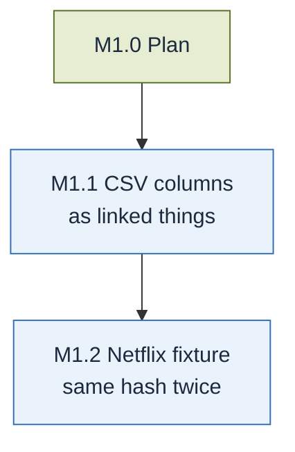

# M1 · Netflix, build side

**Goal** (docs/design.md, Implementation plan → Milestones): Netflix, build side.

**Done when** (copied from docs/design.md): CSV importer that can turn a column into linked
things (optionally split on a separator: directors, cast, countries, genres, years) and convert
dates and mixed fields, mosaic builder (8 steps, build report, strict), `mosaic check`; the
Netflix mosaic builds with the same knowledge hash in repeated clean local builds.

**What `main` already has** (done through GitHub issues before this plan): CSV rows (#67) and
value conversion, dates and mixed units (#77); the mosaic builder's eight steps (#80, #85, #88,
#90); the build report and strict mode (#94); `mosaic check` for files, patterns and proposals
(#76, #75); the CLI `mosaic import csv`, `mosaic build`, `mosaic check` (#95, #96); the Netflix
source pinned in `conformance/fixtures/manifest.json` (243e841). The `Claude review` summaries
on #90, #94, #95 and #96 list no blocking issues.

**What is missing**: issue #12 (columns as linked things) was closed by the closing keywords of
#73, not by a change, so the CSV importer cannot yet turn a column into linked things; and the
Netflix fixture (issue #19) has no settings, pattern or repeated-build test. The slices below
cover only these.

| Done when item | Slice |
| --- | --- |
| CSV importer turns a column into linked things, optionally split on a separator | M1.1 |
| CSV importer converts dates and mixed fields | done (#77); used on Netflix in M1.2 |
| Mosaic builder: 8 steps, build report, strict | done (#80, #85, #90, #94); run on Netflix in M1.2 |
| `mosaic check` | done (#76, #95); run on the Netflix mosaic in M1.2 |
| The Netflix mosaic builds with the same knowledge hash in repeated clean local builds | M1.2 |

The Netflix expected hashes (`conformance/fixtures/netflix/expected*`, CODEOWNERS) belong to
M3's "Done when" ("build with their expected hashes") and are planned there.

## M1.0 Plan
Spec: docs/design.md (Implementation plan → Milestones, First milestone)
Done when:
- [x] `plan/M1.md` covers every item of M1's "Done when" with a slice, starting from what `main` has
Status: done (#100)

## M1.1 CSV columns as linked things, split on a separator
After: M1.0
Spec: docs/design.md (First milestone: "columns as linked things (optionally split on a separator)"); §4.1, §4.3, §3.4, §3.5; issue #12
Done when:
- [ ] Tests on an invented CSV with a multi-valued column split on a separator: one node per distinct value of the column's own type (key = the value), one edge per row and value pair, each node and edge with evidence whose locator points at the row and the column
- [ ] Tests: the settings name, per column, the linked node type, the edge type and its direction; each value is trimmed
- [ ] Tests: an empty cell, and an empty or white-space-only value between separators, make no node and no edge; a column without a separator gives one value per cell
- [ ] Tests: the same source and settings give the same knowledge hash (§4.3), and the linked-column settings are recorded in `header.settings`
- [ ] `mosaic import csv --settings` reads the linked-column settings from the settings file; a wrong setting is an error naming the file, the line and the setting
Status: todo

## M1.2 Netflix fixture: the same knowledge hash in repeated clean builds
After: M1.1
Spec: §11 (Netflix titles), §4, §5, §7.1, §7.2, §3.9
Done when:
- [ ] `conformance/fixtures/netflix/` holds the CSV import settings (directors, cast, countries, genres and years as linked things; `date_added` as a date, `duration` as a quantity) and `pattern.yaml`
- [ ] `pattern.yaml` pins the Netflix tessera by its knowledge hash (§5.1), and the `slow` test fails when the imported tessera's hash differs from the pinned one
- [ ] A `slow` test fetches the source with `scripts/fetch_fixtures.py`, runs `mosaic import csv`, `mosaic build` and `mosaic check` on it, and they pass with a build report valid against `spec/build-report.schema.json`
- [ ] The same `slow` test builds twice from clean directories and gets the same knowledge hash; the PR shows both outputs (knowledge hash, file size, timings)
Status: todo
