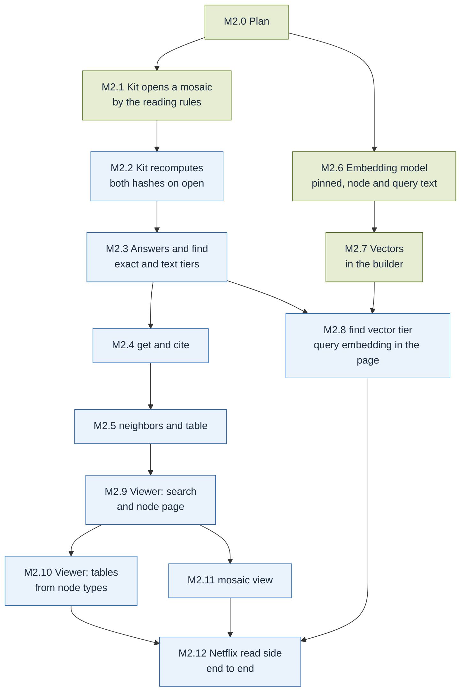

# M2 · Netflix, read side

**Goal** (docs/design.md, Implementation plan → Milestones): Netflix, read side.

**Done when** (copied from docs/design.md): Vectors in the builder; TypeScript kit with `find`,
`get`, `neighbors`, `table`, `cite`; `mosaic view` explores the Netflix mosaic with semantic
search.

**What `main` already has**: the sealed writer stores vectors and `embed_model`, computes the
vector hash (§3.7) and refuses vectors in a tessera; `mosaic check` checks the vector layer
(invariant 14); the target setting `vectors` (default on) is parsed, but a build with it on
writes no vectors and says `vectors skipped, not yet implemented` (decision Q5 on #16); the kit
has only its constants (`FORMAT_VERSION`, `APPLICATION_ID`, `USER_VERSION`, `TOOLS`,
`TEXT_LIMITS`, `cut`); the viewer is a status page; `spec/answers.schema.json` defines every
tool's answer; the Netflix fixture builds with the same knowledge hash twice (M1.2, #102). The
`Claude review` summaries on #101 and #102 list no blocking issues.

**What is missing**: everything the kit reads (§3.8, §8), the vectors themselves (§6, §7.1
step 7), the viewer's search, node page and tables, and `mosaic view`.

| Done when item | Slice |
| --- | --- |
| Vectors in the builder | M2.6, M2.7 |
| TypeScript kit with `find` | M2.1, M2.2 (opening), M2.3 (exact and text tiers), M2.8 (vector tier) |
| TypeScript kit with `get`, `cite` | M2.4 |
| TypeScript kit with `neighbors`, `table` | M2.5 |
| `mosaic view` explores the Netflix mosaic | M2.9, M2.10, M2.11 |
| … with semantic search | M2.8 (in the kit), M2.12 (on Netflix, in `mosaic view`) |

**Order.** The kit's reading rules (§3.8) come before vectors (§6) in the spec and need no
model, so M2.1 to M2.5 do not wait for M2.6. M2.6 needs the model and tokenizer files of §6;
`huggingface.co` is not reachable from an agent environment, so, as for fixture sources, the
files must be on the `fixtures` branch (CLAUDE.md, "Rules for every change"). Until they are,
M2.6 is parked with that need and the kit slices go on.

`path`, the card, view files and export are not in M2 (docs/design.md, First milestone: "Later";
M3). The system-prompt fragment for hosts (§8.2) serves agent hosts, which have no interface
until M7 ("Agent interface: None" in the first milestone); it belongs with the MCP server in M7.

## M2.0 Plan
Spec: docs/design.md (Implementation plan → Milestones, First milestone)
Done when:
- [x] `plan/M2.md` covers every item of M2's "Done when" with a slice, starting from what `main` has, and `plan/README.md` names M2
Status: done (#103)

## M2.1 Kit opens a mosaic by the reading rules
After: M2.0
Spec: §3.8 (steps 1, 2 and 4), §3.1, §3.3, §9, §10; ADR-007 (bare kit)
Done when:
- [x] Kit tests: a valid mosaic opens read-only in SQLite WebAssembly and the kit returns its header fields (§3.3); nothing is written to the file
- [x] Kit tests: a file whose text is not stored as UTF-8 (§3.1, decision B on #104), or with the wrong `application_id` or `user_version`, a schema that is not §3.1's, a missing or malformed header, or a format version the kit does not implement (a newer minor version included, §9) is refused, with an error naming what failed
- [x] The files the kit tests open are in `conformance/`, invented data: `conformance/reading/` (a valid tessera and mosaic that `mosaic check` passes, and one file per rule of §3.8 step 2, a schema that differs from §3.1 included, which the Python reader refuses for the same rule) and the invalid files of `conformance/invalid/files/` that break §3.8 step 2 (`container.tessera`, `inv-1-no-header.tessera`, `inv-1-version.tessera`), each refused by the kit as by `mosaic check`
- [x] `bun run build` builds the kit; the compressed size of the bare kit with SQLite is shown and is under 3 MB (ADR-007)
Status: done (#104)

## M2.2 Kit recomputes the knowledge and vector hashes on open
After: M2.1
Spec: §3.6, §3.7, §3.8 (step 3)
Done when:
- [ ] Kit tests: for every valid file in `conformance/`, the kit's knowledge hash and vector hash equal the header's and those of `mosaic_format`
- [ ] Kit tests: a file with one changed row (a node, an edge, an evidence row, a mention, a vector) is refused on open, naming the hash that differs
- [ ] Kit tests: canonical order compares text by UTF-8 bytes (§3.6), with non-ASCII ids and keys that sort differently by UTF-16
- [ ] The open time with hash checks on a 10,000-node mosaic is shown and is under 3 s in a browser (ADR-007)
Status: todo

## M2.3 Answers and `find` by exact and full-text tiers
After: M2.2
Spec: §8.1 (`find`), §8.2, §8.5 (`find` ranking, answers), §10; `spec/answers.schema.json`
Done when:
- [ ] Kit tests: every answer is the §8.2 envelope (tool name, knowledge hash, `data`) and validates against `spec/answers.schema.json`
- [ ] Kit tests: `find` lists exact id, key and alias matches first (tagged `exact`), then full-text matches not already listed (tagged `text`); within a tier in the engine's order, ties broken by id; optional `type`; `limit` defaults to 20, and lists are cut at 20 with the total
- [ ] Kit tests: text read from the file appears only inside `data`, cut at 120 (labels), 400 (summaries) and 600 (snippets) characters with the marker
- [ ] Kit tests: a query holding full-text syntax (quotes, `*`, `OR`, `NEAR`, unbalanced brackets) is searched as text, never an error or an injected expression (§10)
- [ ] Kit tests (§3.8 step 4, §10, bounded query time and result size): a `limit` above 20 still gives at most 20 items with the total; a query that would run past the kit's documented time bound on a 10,000-node mosaic stops with an error naming the bound, never a hang. `get`, `cite`, `neighbors` and `table` (M2.4, M2.5) are bounded the same way
Status: todo

## M2.4 `get` and `cite`
After: M2.3
Spec: §8.1 (`get`, `cite`, unknown ids), §8.2, §3.5
Done when:
- [ ] Kit tests: `get` returns the node's type, label, summary, properties, aliases, external references and link counts per edge type and direction, valid against the schema
- [ ] Kit tests: `cite` on a node, and on an edge given as `from`, `type`, `to`, returns its evidence rows with source id and hash, locator, method, confidence and snippet
- [ ] Kit tests: an unknown id given to `get` or `cite` is an error naming the closest matches from `find`, never an empty success
Status: todo

## M2.5 `neighbors` and `table`
After: M2.4
Spec: §8.1 (`neighbors`, `table`, unknown ids), §8.2, §10
Done when:
- [ ] Kit tests: `neighbors` with optional `edge`, `direction` (`out`, `in`, `both`) and `limit` (default 20) returns edges with the other node's id and label, and the total count
- [ ] Kit tests: `table` returns rows of one type with its declared properties as columns; `columns`, `order` and `page` work; `where` allows `=`, `!=`, `<`, `<=`, `>`, `>=` and `contains` on declared properties only, and anything else is an error, never raw SQL (a value holding SQL is a value)
- [ ] Kit tests: an unknown id or type is an error naming the closest matches
- [ ] Kit tests: `neighbors` and `table` keep the result-size and time bounds of M2.3 (§3.8 step 4), on a node with more than 20 links and a type with more than one page
- [ ] Tool latency on a 10,000-node mosaic is shown for `find`, `get`, `neighbors`, `cite` and a page of `table` (ADR-007: within 3 times the native 100 ms)
Status: todo

## M2.6 Embedding model pinned; node and query text
After: M2.0
Spec: §6 (model, model file, tokenizer, node text, query text, stored vector), §3.7, ADR-005
Done when:
- [x] The model file and tokenizer of §6 are fetched from an origin an agent environment reaches and checked by their SHA-256; a file with another hash is refused, naming the file and both hashes
- [x] Tests: the node text is `<type> <key>: <label>. 
 <snippet>`, with empty summary and snippet when absent and the snippet cut to its first 800 characters; the query text has the §6 prefix; input is truncated at 256 tokens
- [x] Tests: the embedding is the first token's output divided by its Euclidean norm, and the 48 stored bytes set bit i when dimension i is greater than 0, most significant bit of byte 0 first
- [x] Tests: `embed_model` is `snowflake-arctic-embed-xs@e6aa5e65…89a1` (the full value of §6)
Status: done (#105)

## M2.7 Vectors in the builder
After: M2.6
Spec: §6, §7 (same inputs, same vector hash), §7.1 (step 7), §7.2 (vector hash), §3.7, §3.9 (invariant 14); ADR-005, ADR-007 (build time)
Done when:
- [x] Tests: a target with `vectors: true` gets one vector per node, `embed_model` and the vector hash in the header and in the build report; `vectors: false` gets no vectors and both NULL; the `vectors skipped` message is gone
- [x] Tests: the knowledge hash is the same with vectors on and off, and two builds of the same inputs on one machine give the same vector hash
- [x] Tests: `mosaic check` passes on a mosaic with vectors
- [x] A `slow` test builds the Netflix mosaic with vectors; the PR shows the knowledge hash, vector hash, file size and build time (under 15 min, ADR-007)
Status: done (#107)

## M2.8 `find` vector tier, with query embedding in the page
After: M2.3, M2.7
Spec: §6 (query text, scoring, determinism), §8.5 (`find` ranking), §3.8 (fallback); ADR-005, ADR-007 (single-model kit)
Done when:
- [ ] Kit tests: the kit embeds the query in the page with the §6 model and tokenizer, and scores each node by the dot product of the full-precision normalised query with the stored bits read as +1 and −1, highest first, without turning the query into bits
- [ ] Kit tests: vector matches not already listed come after the exact and text tiers, tagged `vector`, ties broken by id
- [ ] Kit tests: a mosaic without vectors, or whose `embed_model` the kit does not support, opens and `find` uses names and full text only
- [ ] Kit tests: the kit's query vector agrees in sign with the builder's vector of the same text on at least 98 % of the 384 dimensions, on a set of texts (spike S5 measured 0.87 % differing; the agreement is shown in the PR)
- [ ] The compressed size of the kit with the model is shown and is under 60 MB (ADR-007)
Status: todo

## M2.9 Viewer: search box and node page
After: M2.5
Spec: docs/design.md (First milestone: Viewer), §8.1, §8.2; design/ (brand book section 6 "App")
Done when:
- [ ] Viewer tests: the page opens a mosaic with the kit running inside the page, with no query server
- [ ] Viewer tests: the search box calls `find` and lists each result's id, type, label and how it matched
- [ ] Viewer tests: a node page shows what `get` returns, its links from `neighbors` (each one opens the other node) and its sources from `cite`
- [ ] Stylelint and `tests/test_design.py` pass: tokens only
Status: todo

## M2.10 Viewer: tables rebuilt from node types
After: M2.9
Spec: docs/design.md (First milestone: Viewer), §8.1 (`table`)
Done when:
- [ ] Viewer tests: one table per node type the mosaic declares, its columns the type's declared properties, filled by `table`
- [ ] Viewer tests: sorting, filtering by the `where` operators and paging go through `table`; a row opens its node page
Status: todo

## M2.11 `mosaic view`
After: M2.9
Spec: docs/design.md (Implementation plan: Viewer, "`mosaic view` opens the page with a mosaic loaded, no query server"), §3.8
Done when:
- [ ] CLI tests: `mosaic view <mosaic>` opens the viewer page with that mosaic loaded, the file opened read-only and unchanged
- [ ] CLI tests: §3.8 binds "a kit or viewer opening a file", so `mosaic view` applies §3.8 steps 2 and 3 itself before it opens the page: a missing file, or one that fails them (wrong `application_id` or `user_version`, a schema or header that is not §3.1's or §3.3's, a format version it does not implement, a newer minor included, or a knowledge or vector hash mismatch), is an error naming the file and what failed, with exit code 1 and no page opened; the page's kit refuses the same files by the same rules (M2.1, M2.2)
- [ ] `uv run mosaic view --help` documents the command
Status: todo

## M2.12 Netflix read side end to end
After: M2.8, M2.10, M2.11
Spec: §11 (Netflix titles: "open in the kit and the viewer"), §6, §8.5
Done when:
- [ ] A `slow` test builds the Netflix mosaic with vectors and opens it in the kit with both hashes checked
- [ ] A `slow` browser test runs `mosaic view` on the Netflix mosaic and a plain-language query, sharing no word with the title's name, lists that title among the `vector` matches
- [ ] The same test opens the title's node page, its links and its sources, and the table of its type; the PR shows the query, the results and the timings
Status: todo
