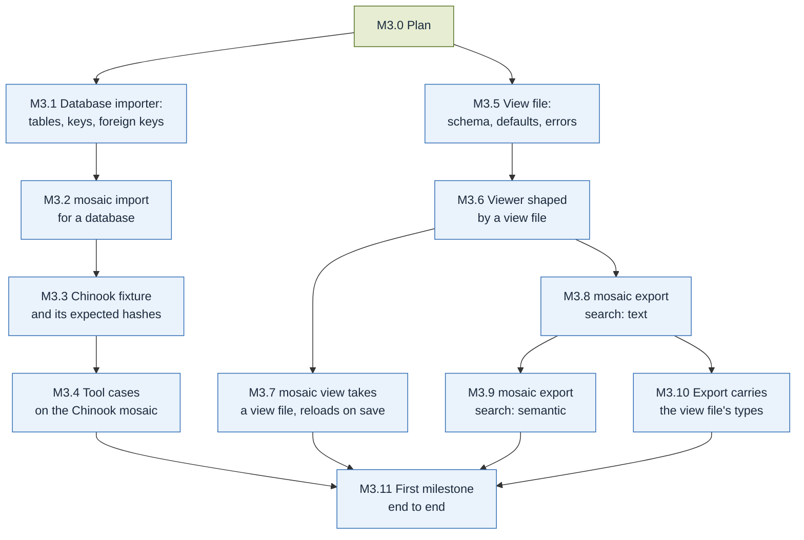

# M3 · First milestone complete

**Goal** (docs/design.md, Implementation plan → Milestones): First milestone complete.

**Done when** (copied from docs/design.md): View files, single-file export with both search
settings, the Chinook fixture and its tool cases pass.

M3 completes the first milestone (docs/design.md: "M1 to M3 are the first milestone above"), so
the first milestone's own "Done when" is checked at the end of M3 too: "the Netflix titles and
Chinook mosaics build with their expected hashes, the viewer opens them offline and exports each
to one HTML file, and a plain-language search finds the right titles."

**What `main` already has** (M2's "Done when" checked from a clean checkout of `a9ac842` in the
M3.0 PR): vectors in the builder; the TypeScript kit with `find` (exact, full-text and vector
tiers), `get`, `neighbors`, `table` and `cite`; the viewer's search box, node page and tables
rebuilt from node types; `mosaic view FILE [--model DIR]`, which serves the page, the checked
mosaic and the pinned model from `127.0.0.1`; the CSV tessera builder and its settings file
(`mosaic import csv --settings`); the Netflix fixture's settings and pattern, built twice with the
same knowledge hash; `conformance/fixtures/manifest.json` pins the Chinook database (MIT,
licence confirmed) and `scripts/fetch_fixtures.py` downloads it; `mosaic export` exists as a
command that says it is not implemented yet; `views/` and `conformance/tools/` hold no files yet.
The `Claude review` summaries on #115, #116 and #117 list no blocking issues.

**What is missing**: a tessera builder for a database (Chinook is one SQLite file), the Chinook
fixture and its expected hashes, the kit tool cases, view files, and `mosaic export`.

| Done when item | Slice |
| --- | --- |
| View files | M3.5 (format), M3.6 (viewer), M3.7 (`mosaic view`) |
| Single-file export with both search settings | M3.8 (`search: text`), M3.9 (`search: semantic`), M3.10 (types an export carries) |
| The Chinook fixture passes | M3.1, M3.2 (importer), M3.3 (fixture and expected hashes) |
| Its tool cases pass | M3.4 |
| First milestone: both mosaics build with their expected hashes, open offline, export to one HTML file, a plain-language search finds the right titles | M3.11 |

**Order.** Two strands share nothing until M3.11: Chinook (M3.1 to M3.4) and view files and
export (M3.5 to M3.10). The view file comes first in its strand because both `mosaic view` and
`mosaic export` are shaped by it (docs/design.md, View file).

**Needs the maintainer, likely.** The spec says what a view file sets but not its fields, so
M3.5 asks for the required settings and their meaning (CLAUDE.md, "Escalate": formats). What an
export "carries" when its view file names only some types is observable (which nodes the file
holds, which knowledge hash it shows, §3.6, §3.8) and not in the spec; M3.10 asks. Chinook has a
table whose primary key has two columns (`PlaylistTrack`) and a foreign key to its own table
(`Employee.ReportsTo`); what the tessera holds for each is observable, and M3.1 asks if §4 does
not settle it. Expected hashes (M3.3, M3.11) and expected tool answers (M3.4) are
CODEOWNERS-protected: those slices propose them and wait for the maintainer.

**Carried from M2.** The built viewer carries ONNX Runtime's WebAssembly (14 MB), loaded only with
a model (#117, note 1): the `search: text` export leaves it out (M3.8). A `Host` header check for
`mosaic view` (#115, note 1) is optional and not planned.

`path`, the card, tiny-mosaic text and the MCP server are not in M3 (docs/design.md, First
milestone: "Later"; M7).

## M3.0 Plan
Spec: docs/design.md (Implementation plan → Milestones, First milestone)
Done when:
- [x] M2's "Done when" checked from a clean checkout of `main`: `./scripts/check-fast.sh` and `uv run pytest -m slow` pass; the PR shows both outputs
- [x] `plan/M3.md` covers every item of M3's "Done when" with a slice, starting from what `main` has, and `plan/README.md` names M3
Status: done (#<PR>)

## M3.1 Database importer: tables, keys and foreign keys
After: M3.0
Spec: §4.1, §4.3, §3.4, §3.5; docs/design.md (First milestone: "Table / CSV importer"; Building GUI: "a CSV file or a database"); principle 8
Done when:
- [ ] Tests on an invented small SQLite database with two foreign keys: each table the settings name gives one node type, each row one node keyed by its primary key, columns its declared props, and each foreign-key value one edge to the row it names
- [ ] Tests: each node and edge has evidence whose locator names the table and the row (§3.5), and the source row's columns keep their values or the settings' conversions
- [ ] Tests: the database is opened read-only and is byte-identical after import (principle 8); the same database and settings give the same knowledge hash (§4.3), with the settings recorded in `header.settings`
Status: todo

## M3.2 `mosaic import` for a database
After: M3.1
Spec: §4.1, §4.3; issue #18 (CSV settings file, the model for this one)
Done when:
- [ ] `mosaic import` gains a kind for one SQLite database, reading its settings from a file as `mosaic import csv --settings` does
- [ ] A wrong setting (an unknown table or column, a foreign key the database does not have) is an error naming the file, the line and the setting, exit 1, and no tessera is written
- [ ] A file that is not a SQLite database is an error naming the file; `--help` documents the kind
Status: todo

## M3.3 Chinook fixture and its expected hashes
After: M3.2
Spec: §11 (Chinook), §5.1, §6, §7.1, §7.2, §3.9
Done when:
- [ ] `conformance/fixtures/chinook/` holds the database import settings and `pattern.yaml` with several linked types, pinning the Chinook tessera by its knowledge hash (§5.1)
- [ ] A `slow` test fetches the source with `scripts/fetch_fixtures.py`, runs `mosaic import`, `mosaic build` (vectors on) and `mosaic check`, and they pass with a build report valid against `spec/build-report.schema.json`
- [ ] Two clean local builds give the same knowledge hash and vector hash; the PR shows both outputs (hashes, file size, timings) and proposes `conformance/fixtures/chinook/expected-hashes.json` for the maintainer
- [ ] The `slow` test fails when a build's knowledge or vector hash differs from `expected-hashes.json`
Status: todo

## M3.4 Kit tool cases on the Chinook mosaic
After: M3.3
Spec: §11 (tool cases), §8.1, §8.2, §8.5, §8.6, `spec/answers.schema.json`
Done when:
- [ ] `conformance/tools/` holds cases (tool, arguments, expected answer) on the Chinook mosaic for `find` (each tier), `get`, `neighbors`, `table` and `cite`, errors included; the expected answers are proposed for the maintainer
- [ ] Kit tests run every case in CI: each answer equals its expected answer and is valid against `spec/answers.schema.json`
- [ ] A case whose expected answer is changed makes the kit test fail
Status: todo

## M3.5 View file: schema, defaults and errors
After: M3.0
Spec: docs/design.md (Implementation plan → View file; Viewer); §10
Done when:
- [ ] `views/` holds the view file's JSON Schema (not a normative file) and an example view file; each fixture's view file is in `conformance/fixtures/<fixture>/`
- [ ] Tests: a view file sets which types appear, columns, what a node page shows, labels, theme, which types an export carries, and `search: semantic` or `search: text`; each setting has a default, so no view file gives the viewer M2 has
- [ ] Tests: a wrong view file (an unknown key, a value of the wrong kind) is an error naming the file, the line and the setting
Status: todo

## M3.6 Viewer shaped by a view file
After: M3.5
Spec: docs/design.md (View file); design/brand-book.md section 6 (SearchField mode switch)
Done when:
- [ ] Viewer tests: the page lists only the view file's types, its tables show the view file's columns, its labels replace type and property names, and node pages show what it sets
- [ ] Viewer tests: the theme and the search field's mode switch (*Semantic* / *Text*) follow the view file
- [ ] Viewer tests: a view file naming a type or property the mosaic does not have shows a notice and the page still opens
Status: todo

## M3.7 `mosaic view` takes a view file and reloads on save
After: M3.6
Spec: docs/design.md (View file: "mosaic view watches it and reloads the page on save"); §3.8
Done when:
- [ ] `mosaic view` takes a view file; a wrong one exits 1 with M3.5's error and no page opens; `--help` documents it
- [ ] A `slow` browser test saves a changed view file while the page is open, and the page reloads shaped by the new file without restarting `mosaic view`
- [ ] A view file saved with an error keeps the page as it was and shows the error
Status: todo

## M3.8 `mosaic export` with `search: text`
After: M3.6
Spec: docs/design.md (Implementation plan → Viewer: "one HTML file that opens offline with a double-click"; View file: `search: text`, "a few MB"); §3.8, §10; principle 8
Done when:
- [ ] `mosaic export` writes one HTML file holding the page, the kit and the mosaic, shaped by a view file; a file the reading rules refuse exits 1 and writes nothing; the source is never written
- [ ] A `slow` browser test opens the export from `file://` with networking blocked: the kit checks both hashes on open, and a name and a full-text search find a node, its node page and its type's table
- [ ] The export carries no embedding model and no ONNX Runtime; its size for Netflix is in the PR
Status: todo

## M3.9 `mosaic export` with `search: semantic`
After: M3.8
Spec: docs/design.md (View file: `search: semantic`, "embedding model inside, about 25 MB"); §6, §3.8
Done when:
- [ ] With `search: semantic` the export carries the pinned model and tokenizer, checked by hash as `mosaic view --model` checks them; a wrong or missing model file exits 1 naming the file
- [ ] A `slow` browser test opens the Netflix export from `file://` with networking blocked, and a plain-language query sharing no word with a title's name lists that title among the `vector` matches
- [ ] The export's size is in the PR
Status: todo

## M3.10 Export carries the view file's types
After: M3.8
Spec: docs/design.md (View file: "which types an export carries"); §3.6, §3.8; principle 6
Done when:
- [ ] Tests: an export whose view file names some types carries those types and no other, and opens by the reading rules (§3.8)
- [ ] Tests: what the export page shows as the mosaic's identity (knowledge hash, name) for such an export follows the maintainer's answer
Status: todo

## M3.11 First milestone end to end
After: M3.4, M3.7, M3.9, M3.10
Spec: docs/design.md (First milestone: "Done when"); §11 (Netflix titles, Chinook)
Done when:
- [ ] A `slow` test builds the Netflix titles and Chinook mosaics from clean directories with their expected hashes (Netflix's `expected-hashes.json` proposed for the maintainer)
- [ ] A `slow` browser test exports each mosaic to one HTML file with each search setting, and opens each from `file://` with networking blocked
- [ ] In those exports a plain-language search finds the right Netflix titles; the PR shows the queries, the results, the sizes and the timings
Status: todo
